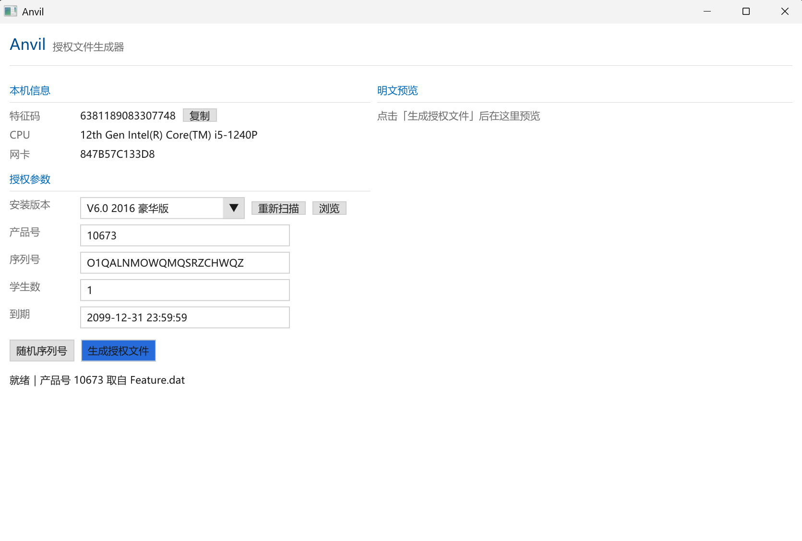

# Anvil

极域课堂管理系统 V6.0（2017 标准版）`.lic` 授权文件生成器。CMake + C++20 + Dear ImGui。

界面用 Dear ImGui 1.93（Win32 + D3D11 后端，源码内置在 `third-party/imgui`），Win10 方正风格；核心逻辑是纯 C++、不依赖 UI，可以单独做 CLI。

## 授权文件的判定链

客户端 `LibLicenseUI.dll` 的导入函数 `sub_1000BD40`，按顺序检查，任何一步失败就返回对应错误码：

| 步骤 | 检查内容 | 错误码 |
|---|---|---|
| 1 | `sub_100065D0` 能否解析（根 `<wks>`、`mainver`、`subver` 属性齐全） | 4 |
| 2 | `<wks mainver>` == 1（对应 `CLicenseUI+0x3B760`） | 7 |
| 3 | `<wks subver>` 是否命中产品表（`Feature.dat` 的 `UninstId%d`） | 8 |
| 4 | `<signature>` == 机器特征码（`+0x3B77C`） | 0x66 |
| 5 | `eclass.type` 与掩码 `+0x3B770`（=3）有交集 → 只能用 1 或 2 | 0x65 |
| 6 | `license.period` 不早于当前时间 | 5 |
| 7 | `sub_100062C0` 序列号格式校验 | 4 |
| ✓ | 成功后写 `C:\Users\Public\Wks\<n>-<product>.dat` | — |

成功后客户端显示「更新授权成功！」，授权信息里出现序列号、席位数与到期时间。

### 产品号从哪来（Feature.dat）

产品号**不是常量**，来自安装目录的 `Feature.dat`，每个版本/版本类型各带一份，所以换版本就可能不同。这个文件是可离线解开的：

```
算法   DES-CBC，IV 全 0，ECB 之外没有别的花样
密钥   "3GNIKNAN"
       由 EXE 里四个常量异或得到：0x7BE ^ 0x4E4149F5 = "KNAN"，
       0x962 ^ 0x494E4E51 = "3GNI"，按 [esp+0xC] 顺序拼成 "3GNIKNAN"
结构   4 字节 "PCLE" + 4 字节版本(0x00020004) + 4 字节记录数
       随后每条 260 字节：键名(256, ASCII, NUL 结尾) + uint32 小端值
关键键 UninstIdCount / UninstId0..N-1（就是产品表）、TrailDays（试用天数）
```

本机实测：40 条记录，`UninstIdCount=1`、`UninstId0=10652`、`TrailDays=30`。

工具会自己从注册表 `HKLM\SOFTWARE\WOW6432Node\Topdomain\e-Learning Class V6.0` 的 `TargetDirectory` 找到 `Feature.dat`，读不到才退回默认值 10652。

### 机器特征码

```
seg  = digits( MD5(cpu_brand + mac) )
code = seg1 "." seg2 "." seg3        # 最多 3 块网卡
```

`digits` 取 MD5 十六进制串**偶数位字符的 ASCII 码 % 10**（不是「两位当十六进制取值」）。
`cpu_brand` 是 CPUID `0x80000002..0x80000004` 的品牌串，去掉尾部空格。

已知测试向量：

```
MD5("12th Gen Intel(R) Core(TM) i5-1240P" + "847B57C133D8")
  = 845f01e93cb5152dbc5a5b2d93a56b00  ->  6381189083307748
```

### 序列号

按**带横杠后的整串长度**判断：

- 20 位：必须全是 `[0-9A-Z]`，**不能有横杠**（客户端自己按 `(i+1)%5` 插入）
- 24 位：横杠只能出现在索引 4 / 9 / 14 / 19

生成器一律输出 20 位不带横杠的形式。

### .lic 编码

```
明文 XML -> 两两展开(a[2k]=0, a[2k+1]=P[k]) -> 与 "mythware" 循环异或 -> hex 文本
```

客户端重新打开时先 hex2bin、异或、相邻字节再异或，才交给 TinyXML。

## 目录

```
src/
├── core/      纯逻辑，无 UI 依赖
│   ├── md5.*          标准 MD5
│   ├── hex.*          十六进制编解码
│   ├── lic_codec.*    .lic 加解密
│   ├── machine_id.*   CPUID + 网卡 -> 机器特征码
│   ├── serial.*       序列号规则与生成
│   └── license.*      授权结构与 XML 构造、落盘
├── ui/        ImGui 界面
│   ├── gfx.*         Win32 窗口 + D3D11 交换链 + 帧循环（含 DPI 缩放）
│   ├── theme.*       Win10 风格主题与字体（雅黑 / Consolas）
│   ├── xml_pretty.*  预览用的 XML 缩进
│   └── app.*         布局、交互、生成流程
└── main/      CLI 入口
tools/         screenshot.py（抓窗口图）、click.py（点控件，回归用）
docs/          screenshot.png
```

## 构建

依赖：Visual Studio 2022+（MSVC）、CMake 3.20+。

第三方只依赖 Dear ImGui 源码，放在 `third-party/imgui/`（需要 `imgui.cpp`、`imgui_draw.cpp`、`imgui_tables.cpp`、`imgui_widgets.cpp` 与 `backends/imgui_impl_win32.*`、`backends/imgui_impl_dx11.*`），无需预编译库，也不需要 FreeType。

VS 直接「打开文件夹」即可识别 CMake 工程；也可以：

```
cmake -S . -B build -G "Visual Studio 18 2026" -A x64
cmake --build build --config Release
```

产物在 `out/bin/`。

## 使用

图形界面：直接运行 `Anvil.exe`（按屏幕 DPI 自动缩放，Win10 方正风格）。



自动化冒烟测试（不开窗口操作，直接跑一次生成流程）：

```
ANVIL_SELFTEST=1 Anvil.exe      # 生成后退出，状态打到 stderr
ANVIL_SELFTEST=run Anvil.exe    # 生成后界面留着，便于抓图
```

命令行：

```
Anvil                                              # 图形界面
Anvil --dump out.lic                               # 解密查看明文
Anvil --feature                                    # 列出 Feature.dat 里的产品号/试用天数
Anvil --probe                                      # 从运行中的教师端读产品号/掩码/机器码
Anvil --code 6381189083307748 --out out.lic        # 命令行生成
Anvil --code ... --students 50 --period 2030-01-01 00:00:00
```

## 范围

仅用于自己拥有授权的教学环境与被授权设备的授权恢复。不提供绕过厂商授权校验之外的能力，也不包含任何联网/破解服务端的功能。
